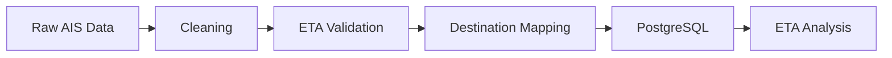

# Vessel-ETA-Reliability
An end-to-end maritime data engineering project built around historical Automatic Identification   
System (AIS) data.  
  
The project focuses on developing a python-based ETL pipeline to clean, validate and standardize  
raw vessel observations, resolve inconsistent destination information and load structured data into  
PostgreSQL for downstream analysis.  
  
To demonstrate the analytical valye of the processed data, the project also investigates discrepancies  
between AIS-reported Estimated Times of Arrival (ETAs) and estimates calculated using a simple model   
that incorporates vessel position, destination coordinates and Speed Over Ground (SOG). These   
discrepancies are compared across three distinct vessel types.

## Project Structure and Pipeline Architecture
```
Vessel-ETA-Reliability/
├── src/                         # ETL pipeline
│   ├── cleaning.py              # Data cleaning
│   ├── eta_validation.py        # ETA anomaly filtering
│   ├── mapping.py               # Destination mapping
│   ├── loading.py               # PostgreSQL loading
│   └── pipeline.py              # Pipeline orchestration
│
├── notebooks/                   # Exploration and analysis
│   ├── data_exploration.ipynb
│   ├── data_cleaning.ipynb
│   ├── ETA_behavior.ipynb
│   ├── destination_mapping.ipynb
│   └── ais_analysis.ipynb
│
├── figures/
│   └── eta_comparison.png       # ETA comparison plot
│
├── .gitignore
└── README.md
```
The ETL pipeline is organized into five sequential stages, transforming raw AIS observations into structured data suitable for analysis.
