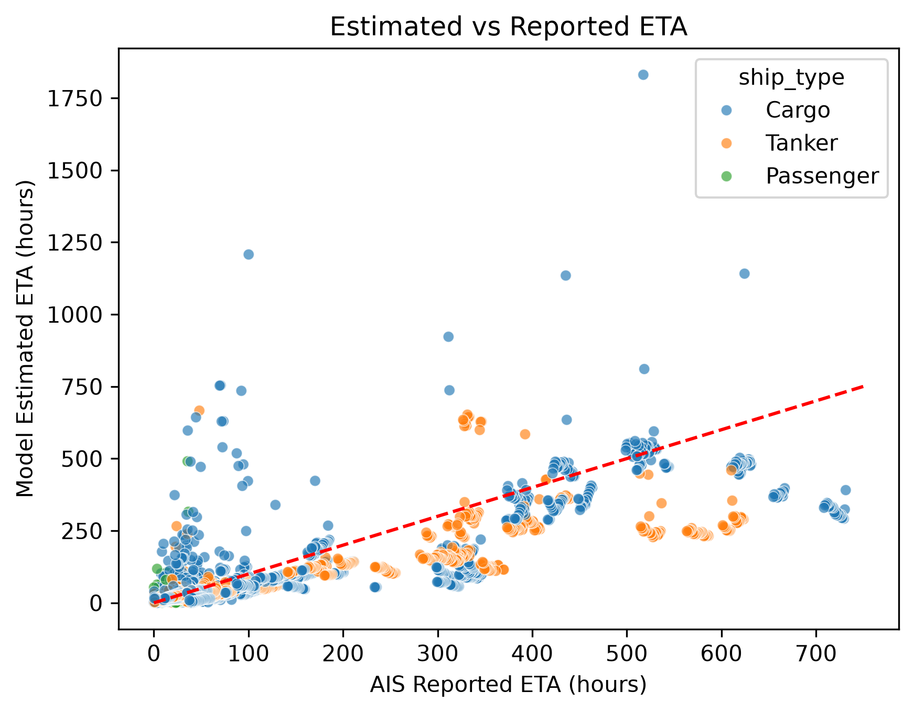

# AIS-Pipeline
An end-to-end maritime data engineering project built around historical Automatic Identification System (AIS) data.  


The project focuses on developing a python-based ETL pipeline to clean, validate and standardize raw vessel observations, resolve inconsistent destination information and load structured data into PostgreSQL for downstream analysis.  
  
To demonstrate the analytical valye of the processed data, the project also investigates discrepancies between AIS-reported Estimated Times of Arrival (ETAs) and estimates calculated using a simple model that incorporates vessel position, destination coordinates and Speed Over Ground (SOG). These discrepancies are compared across three distinct vessel types.

## Project Structure and Pipeline Architecture
The ETL pipeline is organized into five sequential stages, transforming raw AIS observations into structured data suitable for analysis.

```
AIS-Pipeline/
├── src/                                  # ETL pipeline
│   ├── cleaning.py                       # Data cleaning
│   ├── eta_validation.py                 # ETA anomaly filtering
│   ├── mapping.py                        # Destination mapping
│   ├── loading.py                        # PostgreSQL loading
│   └── pipeline.py                       # Pipeline orchestration
│
├── data/
│   ├── raw/                              # External AIS data (ignored)
│   │   └── aisdk-2024-08-07.csv
│   ├── reference/                        # External reference data (ignored)
│   │   ├── UNLOCODE CodeListPart1.csv
│   │   ├── UNLOCODE CodeListPart2.csv
│   │   ├── UNLOCODE CodeListPart3.csv
│   │   └── world_port_index.csv
│   └── mapping/                          # Curated reference datasets
│       ├── destination_aliases.csv
│       ├── manual_port_coordinates.csv
│       └── eta_outliers.csv
│
├── notebooks/                            # Exploration and analysis
│   ├── data_exploration.ipynb
│   ├── data_cleaning.ipynb
│   ├── ETA_behavior.ipynb
│   ├── destination_mapping.ipynb
│   └── ais_analysis.ipynb
│
├── figures/
│   └── eta_comparison.png                # ETA comparison plot
│
├── .gitignore
├── requirements.txt                      # Python dependencies
└── README.md

```

## Technology Stack
- `Python` 3.13.14  — ETL pipeline implementation and data analysis.
- `Pandas` 2.3.3  — Data manipulation and transformations.
- `NumPy` 2.3.4  — Numerical calculations
- `PostgreSQL` 18.6 — Storage and querying of processed AIS data.
- `Psycopg` 3.3.6 — Database connectivity and data loading.
- `Matplotlib` 3.11.2 — Visualization of ETA discrepancies.
- `Seaborn` 0.13.2 — Visualization of ETA discrepancies.
- `Jupyter` 9.16.1 — Exploratory analysis and development of analytical methods.
- `python-dotenv` 1.2.4 — Environment variable and database configuration management.

## Methodology

The pipeline processes historical AIS observations into a structured PostgreSQL dataset through four main stages:

1. **Extraction:** Ingests raw AIS observations alongside UN/LOCODE, World Port Index (WPI), and reference datasets.

2. **Cleaning & Validation:** Filters records by vessel type, navigational status, speed quality, and destination validity. Standardizes destination strings, validates timestamps and reported ETAs, and removes identified ETA anomalies through a key-based anti join.

3. **Destination Resolution & Enrichment:** Converts UN/LOCODE coordinates from degree-minute notation into decimal degrees, supplements missing coordinates using WPI and manually curated references, and resolves non-standard AIS destinations through three matching layers:
   - Exact UN/LOCODE matching
   - Curated port aliases
   - Unambiguous directional-route parsing

   Ambiguous destinations remain unresolved rather than receiving coordinates.

4. **PostgreSQL Loading:** Loads the enriched observations into PostgreSQL using `psycopg` and chunked `COPY` operations, with a transactional full-table refresh on each execution.

5. **Analysis:** Queries the processed AIS dataset from PostgreSQL and estimates remaining travel time using Haversine distance and hourly median Speed Over Ground (SOG). The Haversine formula calculates the great-circle distance between each vessel's observed position and its mapped destination:

$$
d = 2R \arcsin\left(\sqrt{
\sin^2\left(\frac{\phi_2 - \phi_1}{2}\right)
+
\cos(\phi_1)\cos(\phi_2)\sin^2\left(\frac{\lambda_2 - \lambda_1}{2}\right)
}\right)
$$

Where:

- $d$ = great-circle distance  
- $R$ = Earth’s radius (approximately 6371 km)  
- $\phi_1, \phi_2$ = latitudes in radians  
- $\lambda_1, \lambda_2$ = longitudes in radians  

Estimated remaining travel time is then computed as:

$$
T_{\mathrm{estimated}} = \frac{d}{\mathrm{hourly\ median\ SOG} \times 1.852}
$$

where SOG is measured in knots and converted to km/h.

The estimated remaining travel time is compared with the AIS-reported remaining time:

$$
\Delta T = T_{\mathrm{estimated}} - T_{\mathrm{reported}}
$$

Discrepancies are aggregated at the vessel-destination level and further at vessel level to reduce bias from vessels with more frequent AIS transmissions. The resulting distributions are compared across Cargo, Tanker, and Passenger vessels.



## Setup

### Data acquisition
The pipeline uses publicly available historical AIS data and maritime reference datasets. Large external datasets are gitignored and must be downloaded separately.

| Dataset | Source | Local file |
|---|---|---|
| AIS observations (2024-08-07) | [Danish Maritime Authority](http://aisdata.ais.dk/?prefix=2024/) | `data/raw/aisdk-2024-08-07.csv` |
| UN/LOCODE | [UNECE](https://unlocode.unece.org/publications/) | `data/reference/UNLOCODE CodeListPart*.csv` |
| World Port Index | [GitHub](https://gist.github.com/ifeanyiOkey/d0fb94e51ab02e74a825e9fa48a08308) | `data/reference/world_port_index.csv` |

The pipeline also uses curated destination aliases, manually selected port coordinates, and ETA anomaly references stored under `data/mapping/`.

### Installation

Clone the repository and install the required Python dependencies:

```bash
git clone https://github.com/andronbravis/AIS-pipeline.git
cd AIS-Pipeline
python -m pip install -r requirements.txt
```

### Database Configuration

Create a PostgreSQL database and configure the following environment variables in a `.env` file:

```dotenv
DB_NAME=vessel_eta_db
DB_USER=postgres
DB_PASSWORD=your_password
DB_HOST=localhost
DB_PORT=5432
```

Ensure the external datasets are placed in the directories specified above.

### Running the Pipeline

Execute the pipeline from the repository root:

```bash
python src/pipeline.py
```

The pipeline automatically creates the `vessel_eta` table if it does not exist, processes the AIS observations, and bulk-loads the transformed data into PostgreSQL.

**Note:** Each execution replaces the existing contents of the `vessel_eta` table.

## Author

**Andronikos Bravis**  
[GitHub](https://github.com/andronbravis) | [LinkedIn](https://www.linkedin.com/in/andronikos-bravis-2874483a1/)